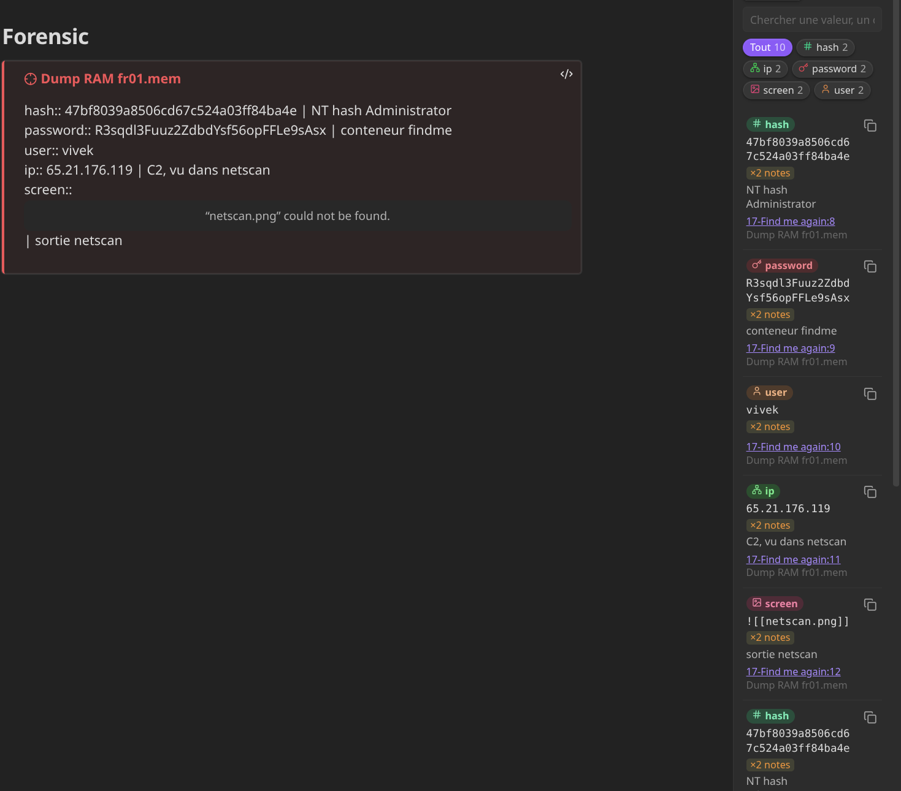

# Case Findings 

Suivi des findings d'une enquête (CTF, DFIR, pentest) : notez vos trouvailles dans un callout `[!finding]`, et une hotkey affiche un tableau filtrable de tout ce que vous avez trouvé dans l'enquête, toutes notes confondues.

## Installation

1. Fermez Obsidian.
2. Copie le dossier `case-findings/` (celui qui contient `main.js`, `manifest.json`, `styles.css`) dans :
   ```
   <vault>/.obsidian/plugins/case-findings/
   ```
3. Obsidian → **Paramètres → Plugins communautaires** → désactivez le mode restreint si besoin → activez **Case Findings**.

> Avec Nextcloud : le dossier `.obsidian/plugins/` se synchronise comme le reste, le plugin sera dispo sur tes autres machines.

## Utilisation



### 1. Rattacher les notes à une enquête

Dans le frontmatter de chaque note de l'enquête :
```yaml
---
case: findme
---
```
Une note peut appartenir à plusieurs enquêtes : `case: [findme, phishing-lab]`.
Raccourci : commande **« Rattacher la note à une enquête (case:) »** (propose les enquêtes existantes).

### 2. Noter les findings

```markdown
> [!finding] Dump RAM fr01.mem
> hash:: 47bf8039a8506cd67c524a03ff84ba4e | NT hash Administrator
> password:: R3sqdl3Fuuz2ZdbdYsf56opFFLe9sAsx | conteneur findme
> user:: vivek
> ip:: 65.21.176.119 | C2, vu dans netscan
> screen:: ![[netscan.png]] | sortie netscan
```

- Une ligne = un finding : `type:: valeur | commentaire`.
- Le type est libre (`hash`, `password`, `user`, `ip`, `domain`, `url`, `email`, `path`, `file`, `process`, `port`, `registry`, `cmd`, `flag`, `screen`…). Les types courants ont une icône.
- Le commentaire est optionnel, séparé par ` | ` (espace-barre-espace). Si la valeur contient elle-même ` | `, mets-la entre backticks : `` password:: `ab | cd` | commentaire ``.
- Le titre du callout est optionnel. Il apparaît sous la source dans le tableau.
- `[!findings]` marche aussi, et tu peux ajouter d'autres noms dans les réglages (ex. `ioc`).
- Les blocs de code, les callouts imbriqués et les lignes sans `::` sont ignorés.

Raccourcis :
- **« Insérer un callout finding »** : insère un modèle prêt à remplir.
- **« Ajouter la sélection comme finding »** : sélectionne un hash / un user dans ta note, lance la commande, choisis le type → un callout est ajouté sous la ligne (ou la ligne est ajoutée au callout si ta sélection est déjà dedans).

### 3. Retrouver

**`Ctrl+Alt+F`** (modifiable dans Paramètres → Raccourcis clavier) ouvre le panneau latéral :

- **Sélecteur d'enquête** : suit automatiquement l'enquête de la note ouverte (📌). Clique sur l'épingle pour figer.
- **Recherche** instantanée sur valeur, commentaire, type, nom de note.
- **Filtres par type** avec compteurs.
- **Clic sur une valeur = copiée.** Bouton copier aussi à droite.
- **Clic sur la source** = ouvre la note à la bonne ligne (`Ctrl+clic` = nouvel onglet).
- **Miniatures** des captures (`screen:: ![[...]]`), clic pour ouvrir l'image.
- **`×2 notes`** : la même valeur apparaît dans plusieurs notes de l'enquête → clic pour filtrer.
- **`↔ autre-enquête`** : la valeur apparaît aussi dans une autre enquête → clic pour y aller. C'est le « j'avais l'info mais je n'y avais pas pensé ».
- **Export** (icône ⬇) : tableau Markdown (pour un writeup), CSV, ou juste la liste des valeurs (pour une wordlist, un grep…).

Commande **« Afficher les findings dans un onglet »** pour le grand tableau en pleine largeur. En panneau étroit, l'affichage passe automatiquement en cartes.

Dans les notes, en **mode lecture**, les callouts finding sont affichés en mini-tableau avec valeurs copiables. En aperçu en direct, ils restent éditables en texte.

## Réglages

- Noms de callout reconnus (défaut : `finding, findings`)
- Champ du frontmatter pour l'enquête (défaut : `case`)
- Suivre la note active (défaut : oui)
- Miniatures des captures (défaut : oui)

## Développement

```bash
npm install
npm run dev     # build en watch (main.js)
npm run build   # build de prod
npm test        # tests du parser
```
Code : `src/parser.ts` (parsing pur, testé) et `src/main.ts` (index, vue, commandes).

## Pistes v2

- Onglet graphe (notes ↔ findings, valeurs partagées)
- Détection automatique des hashes / IP / emails hors callout (désactivable par enquête)
- Export d'une note récapitulative pour le writeup

